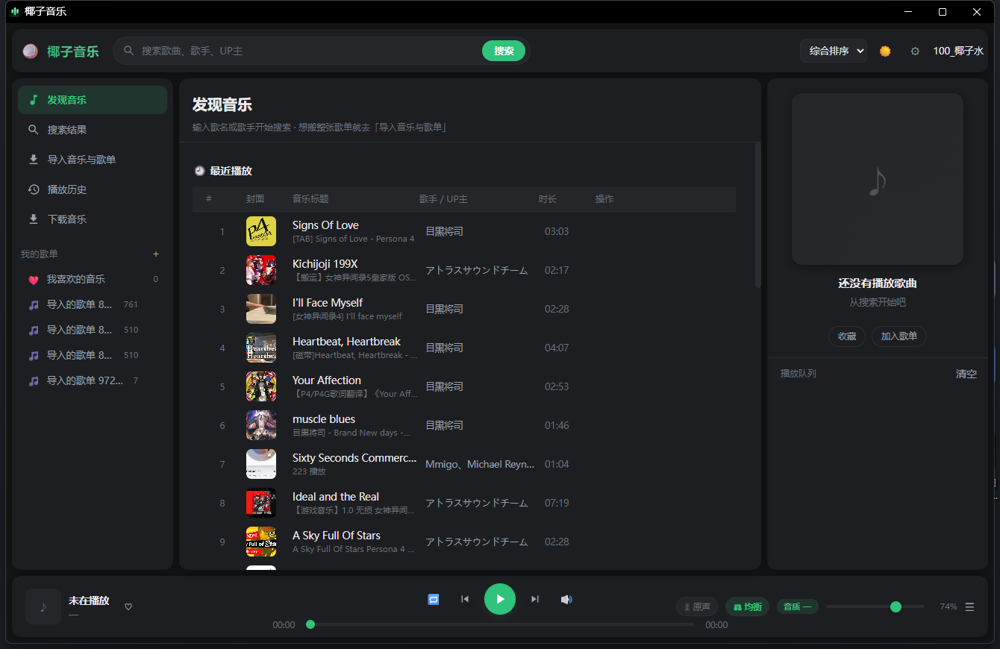

<div align="center">

# 椰子音乐 · Coconut Music

**本地优先的开源桌面音乐播放器**：歌单和设置留在你自己电脑上，音频流从公开接口实时取。

[](https://github.com/Twdhsi-666/coconut-music/releases/latest)
[](LICENSE)
[](https://github.com/Twdhsi-666/coconut-music/releases/latest)
[](https://github.com/Twdhsi-666/coconut-music/stargazers)

[](docs/screenshot-main.png)

</div>

适合这种人：想把 B 站上的歌、翻唱、OST、音效、配音直接存成 MP3 拿去剪视频；不想为听歌装一整客户端，不想把歌单交给别人的云端，也不想自己搭服务器。Windows 端是一个约 39 MB 的单文件 `exe`，双击到窗口出现约 0.9 秒；Android 端是一个 WebView 单文件应用。

**English** — Coconut Music is a free, local-first, open-source music player and audio downloader for Windows and Android. It searches and streams audio from Bilibili without an account, and downloads tracks as 320 kbps CBR MP3 that open in any editor (Premiere, CapCut, Audition, Logic, DaVinci). Playlists, favorites and settings live in a local JSON file; the Windows build is a single ~39 MB `.exe` (PyInstaller, no Python or runtime needed) that opens in about 0.9 s. No account needed to use, no self-hosted server, no telemetry.

> 个人学习项目。使用前请先读 [DISCLAIMER.md](DISCLAIMER.md)。

[下载](#下载) · [它能做什么](#它能做什么) · [可以用它做什么](#可以用它做什么) · [项目结构](#项目结构) · [从源码运行](#从源码运行) · [常见问题](#常见问题) · [参与和反馈](#参与和反馈)

---

## 下载

**直接下成品，不用自己打包：**

👉 [**最新版 椰子音乐.exe**](https://github.com/Twdhsi-666/coconut-music/releases/latest)

Windows 单文件，双击即用，不需要装 Python。首次运行会在同目录建一个 `data\` 文件夹存歌单和设置。

手机端在 [`mobile/椰子音乐4.apk`](mobile/椰子音乐4.apk)。

---

## 它能做什么

- **免登录就能用**：搜索、播放、下载都不需要账号。只有想要 Hi-Res / 杜比音质时才需要扫码登录，凭据只存本机，随时可清。
- **本地优先**：歌单、收藏、播放历史、设置存在本机 JSON 里（原子写入 + 自动 `.bak` 备份），不上传。
- **秒开**：双击到窗口出现约 0.9 秒（冷启动实测），单文件 exe，不需要装运行库。
- **只取音频流**：从 B 站 DASH 里只要纯音频，不碰视频，本地服务代理 Range 请求所以能拖进度条。
- **导入歌单**：贴一张歌单分享链接，只把元数据搬过来；每首歌在第一次播放时才去匹配音源（懒匹配），不批量轰炸接口。
- **下载转 MP3**：音源是 AAC/MP4，下完自动转 320K CBR MP3，文件名自动去重、非法字符替换，转不了就保留原文件并提示，不会假装成功。
- **无遥测**：不埋点、不回传播放记录；联网只发生在搜索、取音频流和下载的时候。

界面是原生 HTML/CSS/JS，没有前端框架；后端除 `requests` 外只用 Python 标准库。音频流走本机回环代理，只监听 `127.0.0.1`，局域网里的其他设备访问不到。

---

## 可以用它做什么

### 想把歌存成 MP3，放进剪辑软件

搜歌名，或者直接贴视频链接，点下载。程序只要 B 站的纯音频流，下完用自带的 ffmpeg 转成 320 kbps CBR 的 `.mp3`——标准 MP3 文件，剪映、Premiere、Audition、达芬奇、手机上的剪辑 App 都能直接拖进去，不用再转一次格式。

源音频本身是 AAC，转码属于二次编码，会有损耗。码率给到 320K 是为了不再往下掉一档。

### 想找冷门的翻唱、OST、音效、配音

音源就是 B 站曲库：华语、日语、欧美、游戏 OST、动画 OP/ED、翻唱、纯音乐、音效、广播剧、有声书、配音素材。搜歌手、歌名、UP 主都行，也可以贴歌单链接把整张单子导进来（只搬元数据，播放到哪首才取哪首）。

B 站上没有的，它也变不出来。

### 不想注册账号

搜索、播放、下载、导入歌单都不需要账号。扫码登录只影响音质上限（Hi-Res / 杜比），Cookie 只存在本机，退出登录就清掉。

### 下载下来的文件在哪，叫什么

存在你选的那个文件夹里，默认是桌面。文件名是「歌手 - 歌名」，重名自动加 `(2)`、`(3)`，`/ \ : * ? " < > |` 这些 Windows 不允许的字符会被换掉，太长会截到 110 字。转码成功会把 `.m4a` 换成同名 `.mp3` 并删掉原文件；转码失败就保留原始 `.m4a` 并在界面上写明原因，不会给你一个假装成功的空文件。

### 歌单和播放记录会不会被传走

不会。歌单、收藏、播放历史、设置都写在本机 `data\library.json`（原子写入，另留一份 `.bak`）。程序只监听 `127.0.0.1`，同一局域网的其他设备也连不上。没有埋点，没有账号体系。

### 一眼看完

| 项目 | 事实 |
|---|---|
| 平台 | Windows 单文件 exe（约 39 MB）/ Android |
| 音源 | B 站公开接口，只取音频流，不取视频 |
| 下载格式 | `.mp3`，320 kbps CBR；转码失败保留 `.m4a` |
| 账号 | 免登录可用；登录只为更高音质 |
| 数据位置 | 本机 `data\` 目录，不上传 |
| 冷启动 | 约 0.9 秒（实测，见 Releases） |
| 许可 | MIT，仅覆盖代码与构建产物 |

---

## 项目结构

```
pc/                         PC 端（Python，除 requests 外都是标准库）
├── app.py                  入口：单实例 / 本地服务 / Edge 应用窗口
├── server.py               HTTP 后端：API 路由、搜索匹配、音频流代理
├── bili.py                 搜索 + 纯音频流（含风控降级，见 MAINTAIN.md 第 2 节）
├── qqmusic.py              歌单元数据解析
├── downloader.py           下载 + AAC→MP3 转码
├── store.py                本地 JSON 数据库
├── share.py / linkparse.py 歌单分享文本、链接识别
├── hotkeys.py / paths.py   全局热键、路径管理
├── web/                    前端（原生 HTML/CSS/JS，无框架）
├── test_search.py          搜索链路自检（需要联网）
├── MAINTAIN.md             ★ 维护指南：为什么代码长这样、踩过哪些坑
└── 椰子音乐.spec            PyInstaller 打包配置

docs/                       截图等展示素材
mobile/                     手机端单文件 WebView 应用 + 安装包
```

---

## 从源码运行

要求 Python 3.11+（开发环境 3.13），只需要 `requests`：

```bash
cd pc
pip install requests
python app.py
```

会自动在 `127.0.0.1:8765` 起本地服务并用 Edge 的应用窗口打开界面（只监听回环地址，局域网访问不到）。

想单独调后端就 `python server.py`；想验证搜索链路就 `python test_search.py`。

## 自己打包

```bash
cd pc
pip install pyinstaller
pyinstaller 椰子音乐.spec --noconfirm
```

产物在 `dist/椰子音乐.exe`。

**打包前建议**从 [Release 页面](https://github.com/Twdhsi-666/coconut-music/releases/latest) 下载 `ffmpeg.xz` 放到 `pc/` 下。
没有它也能打包，exe 照常能用，只是"下载后转 MP3"会降级成"保留原始 .m4a"并在界面上如实提示。

---

## 常见问题

**搜索报"风控拦截"**
B 站会间歇性拦脚本请求，跟你的账号和网络没关系。程序里已经做了三级降级（主接口 → 老接口 → 换匿名身份），
通常还能搜到；三条都失败就是真被拦了，等 1~2 分钟再试。连续快速搜同一个词最容易触发。

**下载下来的文件打不开**
检查是不是 `.m4a`——说明打包时没带 `ffmpeg.xz`。带上它重新打包，或者本机装个带 libmp3lame 的 ffmpeg。

**界面白屏**
`web/` 没打进包。检查 spec 里的 datas，或者直接下 Release 的成品。

**双击没反应**
程序已经在运行了，会把已有窗口切到前台，不会开第二个。

---

## 参与和反馈

用的时候遇到问题，直接在 [Issues](https://github.com/Twdhsi-666/coconut-music/issues) 里说，最好带上：

- 系统版本、是 exe 还是源码运行
- 复现步骤（点了什么、在哪一步断的）
- 界面上报的原文，或者控制台里的最后几行

想改代码的话先读 [`pc/MAINTAIN.md`](pc/MAINTAIN.md)。里面写了每个网络请求为什么那样写、风控的三种表现和应对、
Windows 上那几个绕不开的坑（WebView2 崩溃、任务栏图标、单实例），以及打包发布流程。
所有数字都是实测的，不是估计。

## 更新记录

每个版本改了什么、慢在哪、怎么验证的，都写在 [Releases](https://github.com/Twdhsi-666/coconut-music/releases) 里。

## 合规

本项目不存储、不再分发任何音频内容，音频流实时来自第三方平台公开接口，权利归原权利人所有。
下载功能与在线播放的法律性质不同，请谨慎使用。完整说明见 [DISCLAIMER.md](DISCLAIMER.md)。

## 许可证

[MIT](LICENSE)。仅覆盖本软件的源代码与构建产物，不覆盖通过本软件获取的任何第三方内容。
